# Tom OS Installer TUI

A full-screen terminal app that downloads **Tom OS** and burns it to a USB stick, with the same neon look as the OS itself. It runs on **Linux, macOS and Windows**.

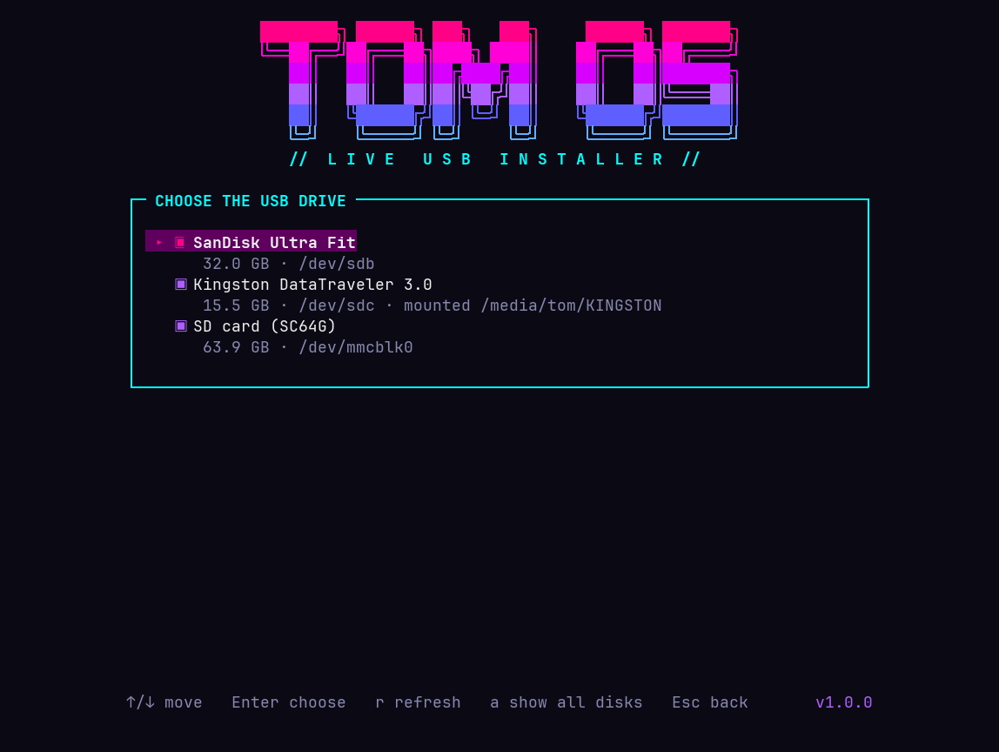

[](https://github.com/Spruhantom/tomos-installer-tui/actions/workflows/test.yml)

## Install (one line)

**Linux and macOS** (any terminal):

```sh
curl -fsSL https://raw.githubusercontent.com/Spruhantom/tomos-installer-tui/main/install.sh | bash
```

**Windows** (PowerShell or Windows Terminal; no admin needed to install):

```powershell
irm https://raw.githubusercontent.com/Spruhantom/tomos-installer-tui/main/install.ps1 | iex
```

Then open a new terminal and run:

```sh
tomos-installer-tui
```

The installer also adds a **Tom OS Installer** entry to your app menu (Linux) or Start menu (Windows).

| | Linux / macOS | Windows |
|---|---|---|
| App | `tomos-installer-tui` (Bash 3.2+) | `tomos-installer-tui.ps1` (PowerShell 5.1 or 7) |
| Installed to | `~/.local/bin` (or `/usr/local/bin` as root) | `%LOCALAPPDATA%\TomOS\installer-tui` |
| Downloads kept in | `~/TomOS` | `%USERPROFILE%\Downloads\TomOS` |
| Asks for permission | `sudo` password when burning | UAC prompt when burning |

## Features

- **Downloads the latest Tom OS release** from [tom-os-hyperland1](https://github.com/Spruhantom/tom-os-hyperland1), in parts, with **resume** if the connection drops. Every part and the joined ISO are checked against the published SHA-256.
- **Reuses** an ISO that's already downloaded and verified, so a second stick is quick.
- **Lists USB drives** with name, size and mount points. Press `a` to see every disk; internal disks are shown but can't be chosen.
- **Burns** the image with a live progress bar, speed and time left. It unmounts the stick first.
- **Reads the stick back** and compares it byte for byte with the image.
- **Type-to-confirm**: you type the drive name (`sdb`, `disk4`, `disk2`) before anything is erased.
- **Also a CLI** for scripts: `--list`, `--info`, `--download`, `--burn`.
- Fits itself to the size of your terminal window.

## Screenshots

| | |
|---|---|
| 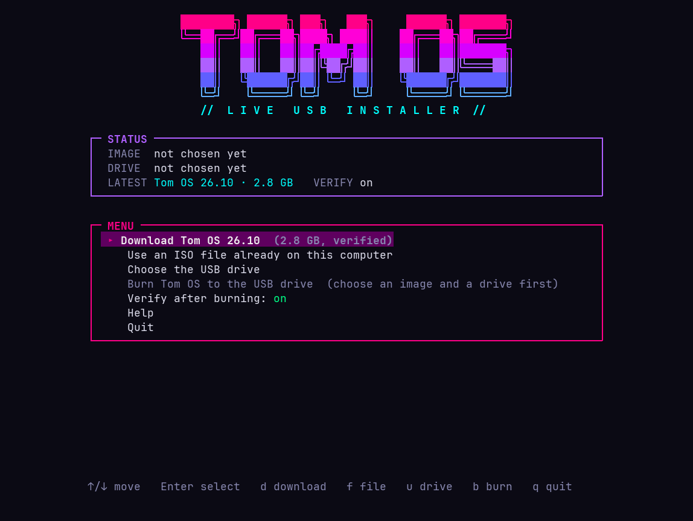 Main menu | 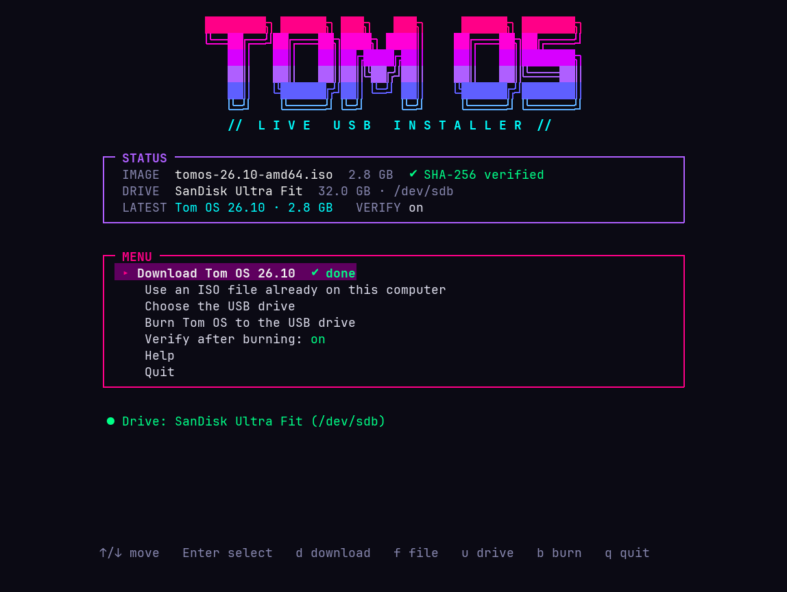 Ready to burn |
|  USB drives | 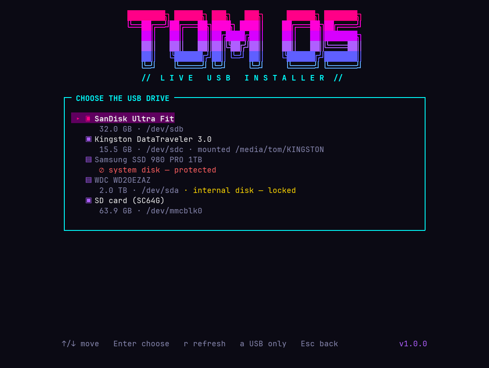 All disks, internal ones locked |
| 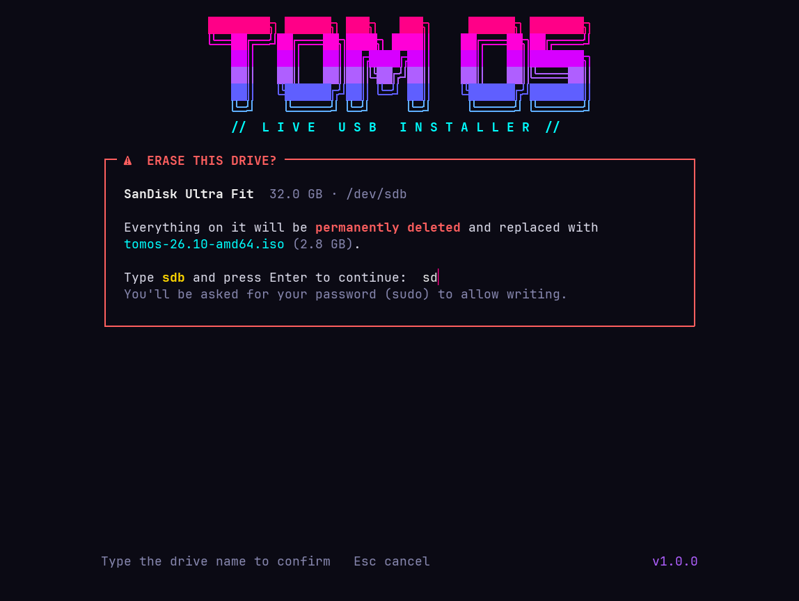 Type the drive name to confirm | 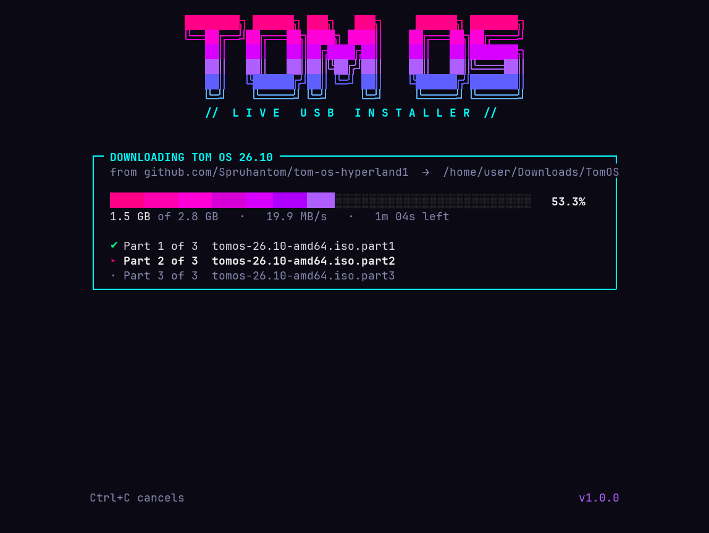 Downloading and verifying |
| 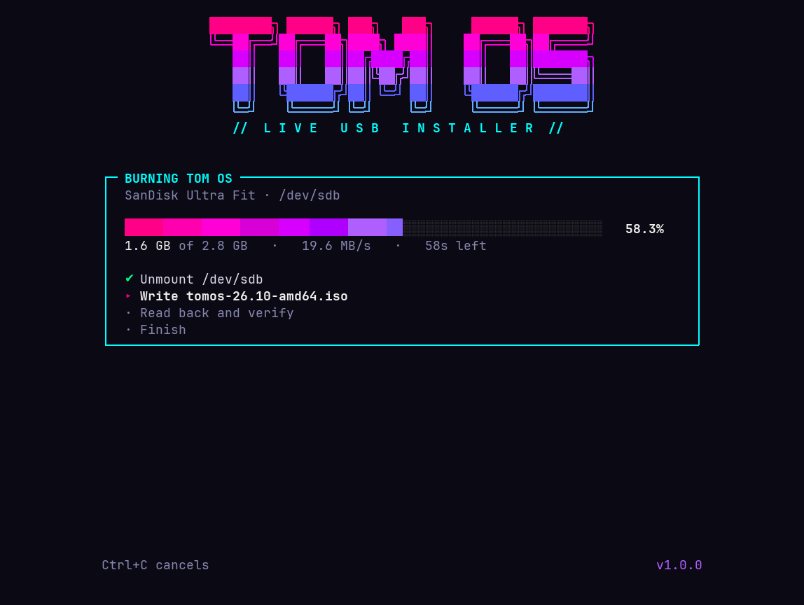 Burning | 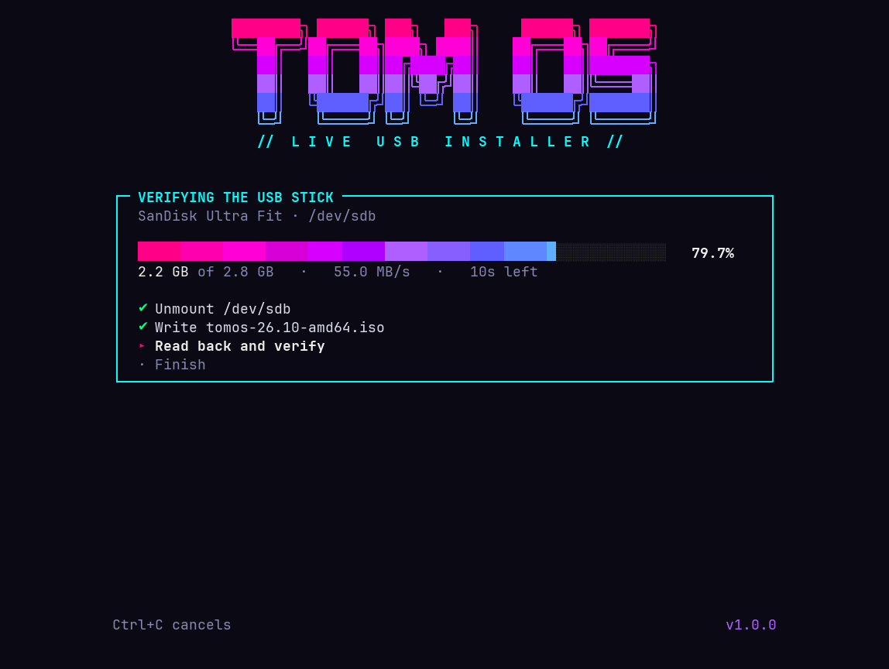 Reading back and checking |
| 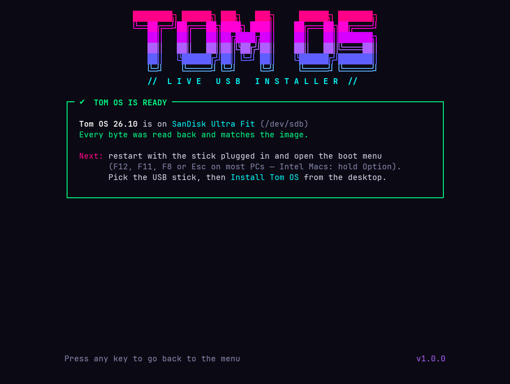 Done, with boot tips | 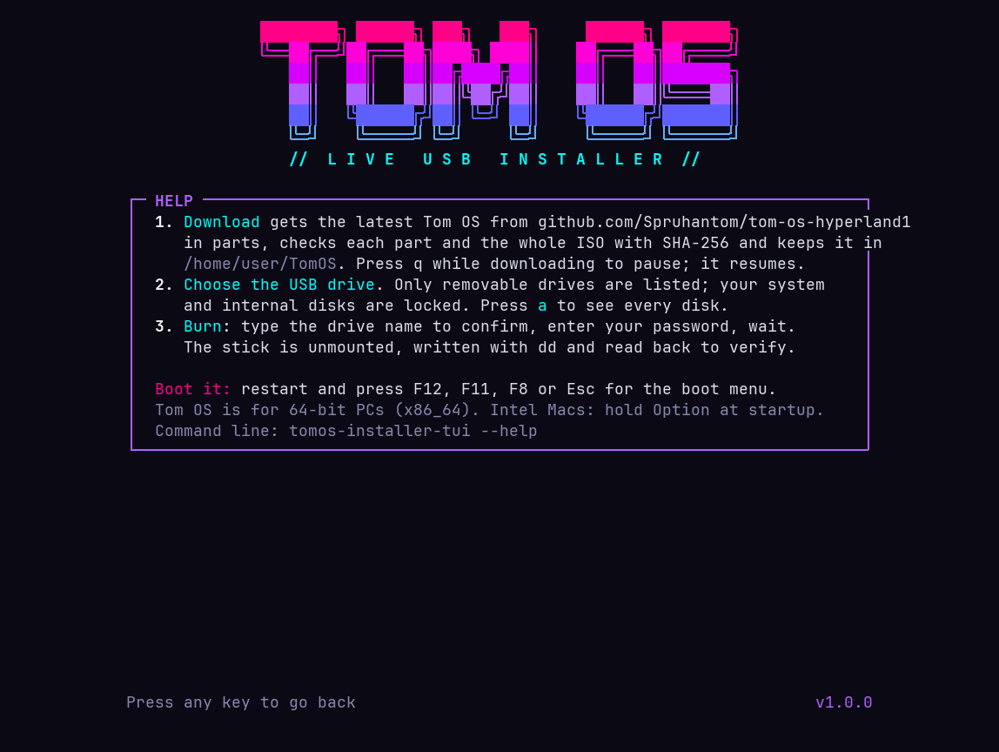 Help |
|  Windows: menu | 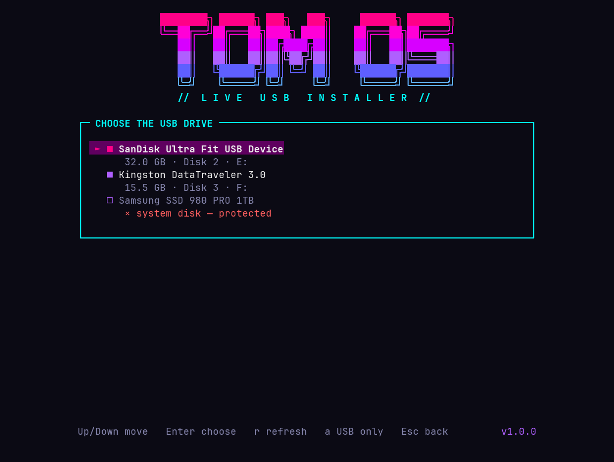 Windows: drives |
| 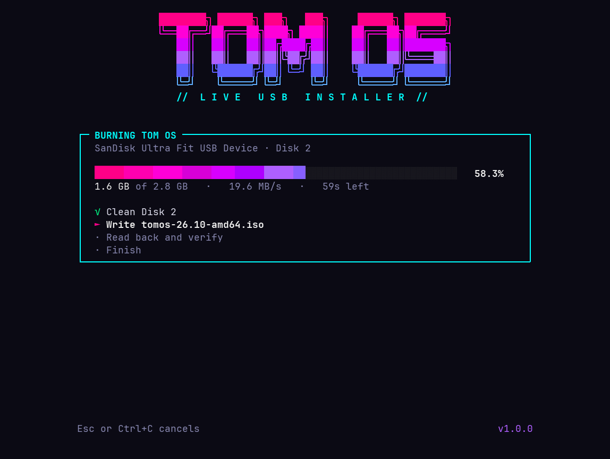 Windows: burning | |

## Using the app

1. **Get Tom OS**: downloads and verifies the ISO (about 2.8 GB). Or choose **Use an ISO file** if you already have one.
2. **Choose the USB drive**: arrow keys and Enter. `r` refreshes after you plug a stick in.
3. **Burn**: type the drive name to confirm. Linux and macOS ask for your password; Windows shows a UAC prompt.
4. When it says **Tom OS is ready**, restart with the stick plugged in and open the boot menu (F12, F11, F8 or Esc on most PCs; hold **Option** on Intel Macs).

Keys: `↑/↓` move, `Enter` choose, `Esc` back, `?` help, `q` quit.

## Command line

Linux / macOS:

```sh
tomos-installer-tui --list [--all]        # list USB drives
tomos-installer-tui --info                # show the latest release
tomos-installer-tui --download            # download + verify into ~/TomOS
tomos-installer-tui --burn /dev/sdb       # Linux
tomos-installer-tui --burn /dev/disk4 --iso ~/Downloads/tomos-26.10-amd64.iso   # macOS
tomos-installer-tui --update | --uninstall | --version | --help
```

Windows (run `--burn` from an **Administrator** terminal; the full-screen app asks for admin by itself):

```powershell
tomos-installer-tui --list
tomos-installer-tui --burn 2              # disk number from --list
tomos-installer-tui --burn 2 --iso C:\Users\me\Downloads\tomos-26.10-amd64.iso
```

Burn options: `--iso FILE` (skip downloading), `--no-verify` (skip read-back), `--yes` (skip the typed confirmation; for scripts).

Environment variables:

| Variable | Meaning |
|---|---|
| `TOMOS_TUI_DIR` | Where downloads are kept |
| `TOMOS_TUI_ALLOW_DEVICE` | Extra device(s) to allow, e.g. an internal SD card reader that isn't reported as removable (`/dev/mmcblk0`, `/dev/disk5`, or a Windows disk number) |
| `TOMOS_TUI_VERSION` | Pick a specific release instead of the latest |
| `NO_COLOR` | Turn off colours (Linux/macOS) |

## Safety

Writing to the wrong disk erases it, so the app is strict:

- **System disks are never offered**: the disk with `/`, `/boot`, the macOS boot volume (including its APFS physical store) or Windows `C:` is marked *protected*.
- **Internal disks are locked**: only removable / USB disks can be chosen. Use `TOMOS_TUI_ALLOW_DEVICE` if you really need an internal card reader.
- **You must type the drive name** before it erases anything.
- Read-only disks and disks smaller than the image are refused.
- After burning, every byte is read back and compared with the image.

## Supported systems

- **Linux**: any distro with Bash, `curl`, `lsblk`, `dd`, `sha256sum` (Ubuntu, Debian, Fedora, Arch, openSUSE, Tom OS, ...). The installer tells you the package command if anything is missing.
- **macOS**: 11 Big Sur or newer, Intel and Apple Silicon. Uses the built-in Bash 3.2, `diskutil` and `dd` on the raw `/dev/rdiskN`.
- **Windows**: 10 and 11, with Windows PowerShell 5.1 (built in) or PowerShell 7. Uses `diskpart` and writes straight to `\\.\PhysicalDriveN`.

## How it was tested

Every push runs [GitHub Actions](.github/workflows/test.yml) on real **Ubuntu, macOS and Windows** machines (Windows twice: PowerShell 5.1 and PowerShell 7). Each job:

1. Installs the tool with the one-line installer.
2. Reads the real Tom OS release info from GitHub.
3. Downloads a test release from a local server, including an interrupted download that has to resume, and checks the SHA-256.
4. **Burns it to a real disk device**: a loop device on Linux, a RAM disk (`hdiutil attach ram://`) on macOS, and an attached VHD on Windows.
5. Reads the disk back with a separate tool (`cmp` / Python) to prove the bytes match.
6. Checks that it refuses to touch the system disk.

## Troubleshooting

- **WSL** can't see USB sticks. Use the Windows one-liner in PowerShell instead.
- **Windows says "You need to format the disk"** after burning: click **Cancel**. Windows can't read the Linux partitions on the stick; that's normal.
- **The stick doesn't show up**: press `r` to refresh, try another port, or press `a` to see all disks. SD card readers are detected automatically; other unusual readers may need `TOMOS_TUI_ALLOW_DEVICE`.
- **The PC won't boot from it**: pick the stick from the boot menu, choose the UEFI entry, and turn off Secure Boot if it refuses.
- **Download keeps failing**: just run it again; it resumes where it stopped.
- **Script blocked on Windows**: the installer uses a `.cmd` shim with `-ExecutionPolicy Bypass`, so no policy changes are needed.

More detail: [docs/HOW-IT-WORKS.md](docs/HOW-IT-WORKS.md).

## Related

- [Tom OS](https://github.com/Spruhantom/tom-os-hyperland1): the distribution
- [Tom OS Installer](https://github.com/Spruhantom/tomos-installer2): the installer that runs inside the live system
- [TDM](https://github.com/Spruhantom/Tomos-display-manager): the Tom OS display manager

## License

MIT, see [LICENSE](LICENSE).

Created with [Perplexity](https://www.perplexity.ai/computer/tasks/ebea3e92-c3a5-4626-a883-38c9c330069a)
